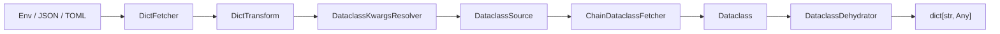

# s7dcls

`Python >= 3.12` · `0 dependencies` · `PEP 561 (py.typed)`

## Install

```bash
pip install git+https://github.com/dusk5archiy/s7dcls.git
```

## Pipeline



## Layout

| File | Role |
| :--- | :--- |
| `protocol.py` | Interface (`*Protocol`) |
| `mechanism.py` / `mechanism/` | Atomic implementations |
| `ops.py` | Closed combinators on same protocol |
| `scaffold.py` | Core algorithms, `Chain*`, `Hub*` |
| `standard.py` | Default presets (`.Args(...).build()`) |

## Patterns

### Prefixes (`ops.py`)

```text
class Sequence(T -> T):
    fn init(fs: [T -> T])
    fn call(x: T) -> T:
        for f in fs:
            x = f(x)
        return x

class Aggregate(A -> M):
    fn init(fs: [A -> M])
    fn call(x: A) -> M:
        return merge(f(x) for f in fs)

class Decorated(A -> B):
    fn init(f: A -> B, t: B -> B)
    fn call(x: A) -> B:
        return t(f(x))

class FirstMatch(X -> Y | None):
    fn init(fs: [X -> Y | None])
    fn call(x: X) -> Y | None:
        for f in fs:
            if (r := f(x)) is not None:
                return r
        return None

class Fallback(X -> Y):
    fn init(fs: [X -> Y])
    fn call(x: X) -> Y:
        for f in fs:
            try:
                return f(x)
            except (TypeError, ValueError):
                continue
        raise ...

class All(X -> None):
    fn init(cs: [X -> None])
    fn call(x: X) -> None:
        for c in cs:
            c(x)

class Any(X -> None):
    fn init(cs: [X -> None])
    fn call(x: X) -> None:
        for c in cs:
            try:
                c(x)
                return
            except (TypeError, ValueError):
                continue
        raise ...
```

### Prefixes (`scaffold.py` & `standard.py`)

```text
class Chain[B](A -> C):
    fn init(f: A -> B, g: B -> C)
    fn call(x: A) -> C:
        return g(f(x))

class Hub[B](A -> C):
    fn init(spawner: (A -> C) -> (A -> B), map_result: B -> C):
        worker: A -> B = spawner(self)
    fn call(x: A) -> C:
        return map_result(worker(x))

class Scaffold(X -> Y):
    fn init(**deps)
    fn call(x: X) -> Y:
        return core_algorithm(deps, x)

class Standard(X -> Y):
    fn build(args: Args) -> Standard(X -> Y)
    fn call(x: X) -> Y
```

### Suffixes

```text
Emitter[T]   := () -> T
Transform[T] := T -> T
Gate[T]      := T -> T | None
Checker[T]   := T -> None | err
Worker       := X -> Result | None
Spawner      := (A -> C) -> (A -> B)
```

## Conventions

- Parameter order: `(value, dtype)` · `(data, datacls)` · `(source, datacls)`
- Errors: `TypeError({...})` / `ValueError({...})` structured `dict` payloads

## Examples

### Hydrate & Dehydrate

```python
from dataclasses import dataclass
from pathlib import Path
from typing import Annotated

from s7dcls import (
    Gt,
    StandardDataclassDehydrator,
    StandardDataclassHydrator,
)


@dataclass(kw_only=True, frozen=True)
class Config:
    root: Path
    port: Annotated[int, Gt(limit=0)] = 8000


hydrator = StandardDataclassHydrator.Args().build()
dehydrator = StandardDataclassDehydrator.Args().build()

cfg = hydrator(data={"root": "/var/run", "port": 8080}, datacls=Config)
raw = dehydrator(instance=cfg)  # {"root": "/var/run", "port": 8080}
```

### Layered Fetch

```python
from pathlib import Path

from s7dcls import (
    AggregateDataclassSource,
    ChainDataclassFetcher,
    NoCasePrefixGate,
    StandardDataclassSource,
    StandardFileDictFetcher,
    StandardShellDictFetcher,
    StandardStringCoercer,
)

source = AggregateDataclassSource(
    sources=(
        StandardDataclassSource.Args(
            dict_fetcher=StandardFileDictFetcher.Args(
                file=Path("config.toml"),
                key_path=("app",),
            ).build(),
        ).build(),
        StandardDataclassSource.Args(
            dict_fetcher=StandardShellDictFetcher.Args(
                key_gate=NoCasePrefixGate(prefix="__APP__"),
            ).build(),
            coercer=StandardStringCoercer.Args().build(),
        ).build(),
    )
)

cfg = ChainDataclassFetcher(source=source, datacls=Config)()
```

### Coerce, Validate & Describe

```python
from typing import Annotated

from s7dcls import (
    AnyValueChecker,
    Gt,
    Lt,
    StandardJsonCoercer,
    StandardTypeDescriber,
    StandardValidator,
)

coercer = StandardJsonCoercer.Args().build()
validator = StandardValidator.Args().build()
describer = StandardTypeDescriber.Args().build()

ports = coercer(value=[80, 443], dtype=tuple[int, ...])  # tuple[int, ...]
validator(
    value=-5,
    dtype=Annotated[int, AnyValueChecker(checkers=(Lt(limit=0), Gt(limit=10)))],
)
schema = describer(dtype=Config)
```

### Custom Hub Coercer

```python
from dataclasses import dataclass
from typing import Any
from uuid import UUID

from s7dcls import CoerceResult, FirstMatchCoercerWorker, HubCoercer
from s7dcls.coercers.mechanism import ListCoercerWorker


@dataclass(kw_only=True, frozen=True)
class UuidCoercerWorker:
    def __call__(self, *, value: Any, dtype: Any) -> CoerceResult[UUID] | None:
        if dtype is not UUID:
            return None
        if isinstance(value, str):
            return CoerceResult(value=UUID(value))
        raise TypeError(
            {
                "value": value,
                "expected_type": str(UUID),
                "got_type": str(type(value)),
            }
        )


coercer = HubCoercer(
    spawner=lambda hub: FirstMatchCoercerWorker(
        workers=(ListCoercerWorker(hub=hub), UuidCoercerWorker())
    )
)
ids = coercer(value=["12345678-1234-5678-1234-567812345678"], dtype=list[UUID])
```

## Dev

```bash
PYTHONPATH=src python3 -m unittest discover -s tests -v
uvx ruff format --check && uvx ruff check
uvx pyright && uvx basedpyright --level error
```
