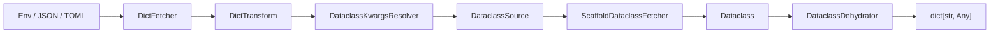

# s7dcls

`Python >= 3.12` · `0 dependencies` · `PEP 561 (py.typed)`

## Install

```bash
pip install git+https://github.com/dusk5archiy/s7dcls.git
```

## Pipeline



## Examples

| File | Scope |
| :--- | :--- |
| [hydrate_dehydrate.py](examples/hydrate_dehydrate.py) | Hydrate & dehydrate |
| [layered_fetch.py](examples/layered_fetch.py) | TOML + ENV layered fetch |
| [coerce_validate_describe.py](examples/coerce_validate_describe.py) | Coerce, validate, schema |
| [custom_hub_coercer.py](examples/custom_hub_coercer.py) | Custom `HubCoercer` worker |
| [llm_tool_calling.py](examples/llm_tool_calling.py) | LLM JSON Schema + retry |
| [fastapi_adapter.md](examples/fastapi_adapter.md) | FastAPI body + HTTP 422 |

## Docs

- [docs/ARCHITECTURE.md](docs/ARCHITECTURE.md) — package layout, naming patterns, and conventions

## Dev

```bash
PYTHONPATH=src python3 -m unittest discover -s tests -v
uvx ruff format --check && uvx ruff check
uvx pyright && uvx basedpyright --level error
```
