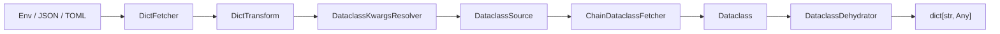

# s7dcls

`Python >= 3.12` · `0 dependencies` · `PEP 561 (py.typed)`

## Install

```bash
pip install git+https://github.com/dusk5archiy/s7dcls.git
```

## Pipeline



## Layout

| File | Role |
| :--- | :--- |
| `protocol.py` | Interface (`*Protocol`) |
| `mechanism.py` / `mechanism/` | Atomic implementations |
| `ops.py` | Closed combinators on same protocol |
| `scaffold.py` | Core algorithms, `Chain*`, `Recursive*` |
| `standard.py` | Default presets (`.Args(...).build()`) |

## Naming Algebra

### Prefixes

| Prefix | Type Shape | File |
| :--- | :--- | :--- |
| `Sequence*` | `(A -> A)^n -> (A -> A)` | `ops.py` |
| `Aggregate*` | `(1 -> M)^n -> (1 -> M)` (merge) | `ops.py` |
| `Decorated*` | `(A -> B) + (B -> B) -> (A -> B)` | `ops.py` |
| `FirstMatch*` | `(X -> Y \| None)^n -> (X -> Y \| None)` | `ops.py` |
| `Fallback*` | `(X -> Y \| err)^n -> (X -> Y \| err)` | `ops.py` |
| `All*` / `Any*` | `(X -> None \| err)^n -> (X -> None \| err)` | `ops.py` |
| `Chain*` | `(A -> B) + (B -> C) -> (A -> C)` | `scaffold.py` |
| `Recursive*` | `((X -> Y) -> (X -> Y \| None)) -> (X -> Y)` | `scaffold.py` |
| `Scaffold*` | Algorithm template / strictify | `scaffold.py` |
| `Standard*` | `.Args(...).build()` preset | `standard.py` |

### Suffixes

| Suffix | Type Shape |
| :--- | :--- |
| `*Emitter` | `() -> T` |
| `*Transform` | `T -> T` |
| `*Gate` | `T -> T \| None` |
| `*Checker` | `T -> None \| err` |
| `*Recursion` | `(X -> Y) -> (X -> Y \| None)` |

## Conventions

- Parameter order: `(value, dtype)` · `(data, datacls)` · `(source, datacls)`
- Errors: `TypeError({...})` / `ValueError({...})` structured `dict` payloads

## Examples

### Hydrate & Dehydrate

```python
from dataclasses import dataclass
from pathlib import Path
from typing import Annotated

from s7dcls import (
    Gt,
    StandardDataclassDehydrator,
    StandardDataclassHydrator,
)


@dataclass(kw_only=True, frozen=True)
class Config:
    root: Path
    port: Annotated[int, Gt(limit=0)] = 8000


hydrator = StandardDataclassHydrator.Args().build()
dehydrator = StandardDataclassDehydrator.Args().build()

cfg = hydrator(data={"root": "/var/run", "port": 8080}, datacls=Config)
raw = dehydrator(instance=cfg)  # {"root": "/var/run", "port": 8080}
```

### Layered Fetch

```python
from pathlib import Path

from s7dcls import (
    AggregateDataclassSource,
    ChainDataclassFetcher,
    NoCasePrefixGate,
    StandardDataclassSource,
    StandardFileDictFetcher,
    StandardShellDictFetcher,
    StandardStringCoercer,
)

source = AggregateDataclassSource(
    sources=(
        StandardDataclassSource.Args(
            dict_fetcher=StandardFileDictFetcher.Args(
                file=Path("config.toml"),
                key_path=("app",),
            ).build(),
        ).build(),
        StandardDataclassSource.Args(
            dict_fetcher=StandardShellDictFetcher.Args(
                key_gate=NoCasePrefixGate(prefix="__APP__"),
            ).build(),
            coercer=StandardStringCoercer.Args().build(),
        ).build(),
    )
)

cfg = ChainDataclassFetcher(source=source, datacls=Config)()
```

### Coerce, Validate & Describe

```python
from typing import Annotated

from s7dcls import (
    AnyValueChecker,
    Gt,
    Lt,
    StandardJsonCoercer,
    StandardTypeDescriber,
    StandardValidator,
)

coercer = StandardJsonCoercer.Args().build()
validator = StandardValidator.Args().build()
describer = StandardTypeDescriber.Args().build()

ports = coercer(value=[80, 443], dtype=tuple[int, ...])  # tuple[int, ...]
validator(
    value=-5,
    dtype=Annotated[int, AnyValueChecker(checkers=(Lt(limit=0), Gt(limit=10)))],
)
schema = describer(dtype=Config)
```

### Custom Recursive Coercer

```python
from dataclasses import dataclass
from typing import Any
from uuid import UUID

from s7dcls import CoerceResult, FirstMatchCoercer, RecursiveCoercer
from s7dcls.coercers.mechanism import ListCoercer


@dataclass(kw_only=True, frozen=True)
class UuidCoercer:
    def __call__(self, *, value: Any, dtype: Any) -> CoerceResult[UUID] | None:
        if dtype is not UUID:
            return None
        if isinstance(value, str):
            return CoerceResult(value=UUID(value))
        raise TypeError(
            {
                "value": value,
                "expected_type": str(UUID),
                "got_type": str(type(value)),
            }
        )


coercer = RecursiveCoercer(
    coercer_recursion=lambda inner: FirstMatchCoercer(
        coercers=(ListCoercer(inner_coercer=inner), UuidCoercer())
    )
)
ids = coercer(value=["12345678-1234-5678-1234-567812345678"], dtype=list[UUID])
```

## Dev

```bash
PYTHONPATH=src python3 -m unittest discover -s tests -v
uvx ruff format --check && uvx ruff check
uvx pyright && uvx basedpyright --level error
```
